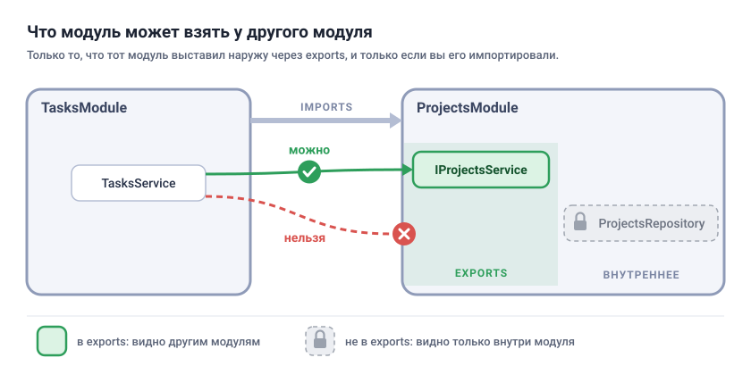
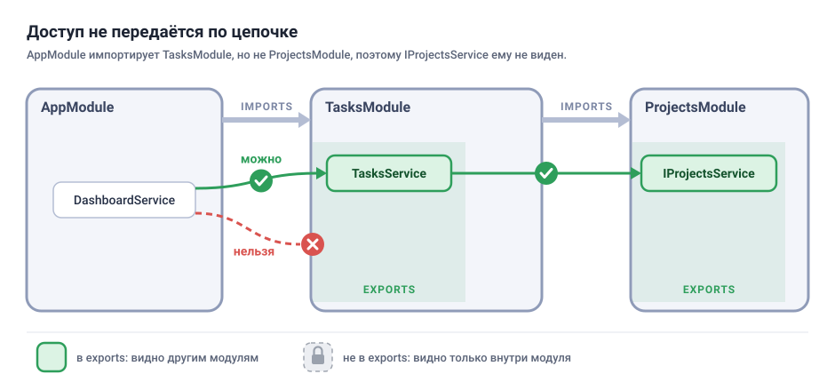
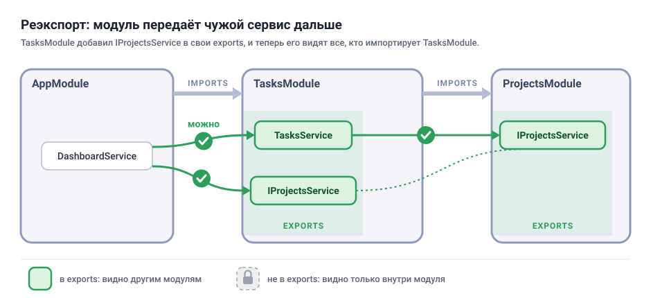

# Инкапсуляция модулей

Основы описаны в главе [Модули](modules.md#границы-что-видно-другим-модулям):
модуль `B` может внедрить сервис модуля `A`, только если `B` импортирует `A`,
а `A` отдаёт этот сервис в `exports`. Здесь — правила подробнее и случаи,
на которых обычно спотыкаются.

Все примеры проверены на bazis 0.142.0.

## Правило в одной картинке



`TasksService` получит `IProjectsService`: `TasksModule` импортирует `ProjectsModule`,
а тот перечислил `IProjectsService` в `exports`. `ProjectsRepository` в `exports` нет, поэтому
его не получит никто за пределами `ProjectsModule`. Уберите `ProjectsModule` из
`imports` или `IProjectsService` из `exports`, и приложение не запустится.

## Видимость не передаётся по цепочке

```ts
@Module({ providers: [scoped(IProjectsService, ProjectsService)], exports: [IProjectsService] })
export class ProjectsModule {}

@Module({ imports: [ProjectsModule], providers: [scoped(TasksService)], exports: [TasksService] })
export class TasksModule {}

@Module({ imports: [TasksModule], providers: [scoped(DashboardService)], exports: [] })
export class AppModule {}
```



`TasksService` может зависеть от `IProjectsService`. А `DashboardService` из `AppModule` —
нет, хотя `AppModule` импортирует `TasksModule`, а тот — `ProjectsModule`:

```text
Module encapsulation violated:
Module "AppModule": "DashboardService" depends on "IProjectsService", which its import "TasksModule" receives
from "ProjectsModule" but does not export. Add "ProjectsModule" to the imports of "AppModule", or add it to the
exports of "TasksModule".
```

Выхода два, и сообщение называет оба:

- импортировать `ProjectsModule` в `AppModule` — модуль перечисляет в
  `imports` всё, чем пользуется сам, и по объявлению видно, от чего он
  зависит;
- или [реэкспортировать](#реэкспорт) `IProjectsService` из `TasksModule` — если
  `IProjectsService` действительно часть того, что `TasksModule` отдаёт наружу.

> [!NOTE]
> Оба выхода в сообщении — с версии 0.109.0. Раньше оно предлагало только
> реэкспорт.

## Реэкспорт

Модуль может отдать дальше токен, который сам импортировал:

```ts
@Module({ imports: [ProjectsModule], providers: [scoped(TasksService)], exports: [TasksService, IProjectsService] })
export class TasksModule {}
```



Теперь `IProjectsService` видят все, кто импортирует `TasksModule`. Реэкспортировать
модуль целиком нельзя: в `exports` перечисляются только токены и классы.

Отдать то, чего у модуля нет, тоже нельзя:

```text
Module encapsulation violated:
Module "Empty" exports "IProjectsService" which it neither provides nor imports.
```

## Общий модуль у нескольких

Если `ProjectsModule` импортируют два модуля, сервис создаётся один раз: оба
получают один и тот же экземпляр singleton. Повторные импорты и «ромбы» в
графе модулей — обычное дело.

## Одна реализация на токен

В приложении один реестр сервисов. Если один и тот же токен
зарегистрирован в нескольких модулях, всё приложение получает **последнюю**
регистрацию.

Так можно подменить реализацию из чужого модуля:

```ts
@Module({ providers: [scoped(IProjectsService, ProjectsService)], exports: [IProjectsService] })
export class ProjectsModule {}

@Module({ imports: [ProjectsModule], providers: [scoped(IProjectsService, DemoProjectsService), scoped(DashboardService)], exports: [] })
export class AppModule {}
// DashboardService получает DemoProjectsService
```

Но если исходный модуль сам пользуется этим токеном (скажем, в `ProjectsModule` есть
`ProjectStats`, которому нужен `IProjectsService`), подмена ломает его:
сервисы `ProjectsModule` получили бы реализацию из `AppModule`, которую
`ProjectsModule` не видит. Запуск останавливается:

```text
Module encapsulation violated:
Module "ProjectsModule": "ProjectStats" depends on "IProjectsService", but "IProjectsService" is registered in
"ProjectsModule" and "AppModule", and the application uses one implementation per token, the last registered
one, from "AppModule", which "ProjectsModule" cannot see. Register "IProjectsService" in one module, or give
each implementation its own contract.
```

Если разным частям приложения действительно нужны разные реализации,
дайте каждой [свой контракт](../services/dependency-injection.md#конкретная-реализация-из-нескольких).

> [!NOTE]
> Сообщение в таком виде — с версии 0.97.7.

## Модуль без `exports`

Если поле `exports` не указано, модуль открыт целиком: импортирующим видны
все его сервисы. `exports: []` — наоборот, всё приватно. Указывайте
`exports` всегда; CLI так и создаёт модули.

## Глобальные модули

`@Global()` делает `exports` модуля видимыми всем без `imports`. Но сам
модуль должен попасть в приложение — быть импортированным хотя бы раз,
обычно в корневом модуле или через `infra`. Иначе его сервисов в
приложении просто нет:

```text
Service graph validation failed:
Missing dependency "IProjectsService" for "DashboardService"
```

## Модули с параметрами

Модуль не обязан быть классом: подходит и обычный объект с теми же полями.
Это удобно, когда модулю нужны настройки:

```ts
export function projectsModule(options: { demo: boolean }) {
  return {
    providers: [singleton(IProjectsService, options.demo ? DemoProjectsService : ProjectsService)],
    exports: [IProjectsService],
  };
}

@Module({ imports: [projectsModule({ demo: true })], providers: [scoped(DashboardService)], exports: [] })
export class AppModule {}
```

Так устроены `memory()` для кэша и `httpModule(...)` внутри `runApp`.

## Чего `exports` не ограничивает

- **Ручное получение сервиса.** `ctx.services.resolve(PrivateService)` в
  middleware, проверке доступа или через `ServiceProvider` вернёт сервис из
  любого модуля: границы проверяются для конструкторов и при сборке
  приложения, а ручной `resolve` — точка сборки, ей видно всё. Не
  обходите так `exports` в коде функций.
- **HTTP, фоновые службы, AI-инструменты.** Контроллеры работают при любых
  `exports` — доступ к ним настраивается через
  [`@Authorize`](../controllers/authorization.md).
- **Импорты TypeScript.** `exports` в `@Module` — граница для DI, а не для
  `import` в коде. Что модуль отдаёт как TypeScript-API, решает его
  `index.ts`.

## Дальше

- [Модули](modules.md)
- [DI подробно](../services/dependency-injection.md)
- [Архитектура модулей](module-architecture.md)
