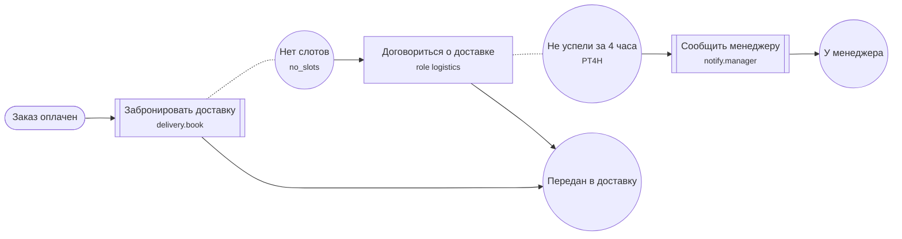

# Бизнес-процессы

Процесс — это граф шагов, который описан данными и исполняется сам: «принять
заказ → списать оплату → если не прошла, поручить сотруднику позвонить
клиенту». Шаги, которые действуют, — это [инструменты](../ai/tools.md)
модулей. Шаги, которые ждут человека, — задачи сотрудникам.

`WorkflowModule` даёт каталог процессов, публикацию версий, исполнение в
базе, фоновый воркер, события и HTTP. Интерфейса нет: дизайнер процессов,
входящие задачи и формы строит приложение поверх сервисов и HTTP модуля.

Все примеры проверены на bazis 0.124.0–0.131.0 с PostgreSQL 17 в приложении
«Заказы» из этой главы. Готовое приложение — в
[examples/workflow](https://github.com/asus97178/bazis/tree/main/examples/workflow).

## Подключение

```ts
import { Module, singletonValue } from "bazis/core/di";
import { TOOL_EXECUTION_OPTIONS } from "bazis/core/agent";
import { WorkflowModule } from "bazis/core/workflow";

@Module({
  imports: [AppInfra, WorkflowModule, PaymentsModule],
  roles: appRoles,
  providers: [
    singletonValue(TOOL_EXECUTION_OPTIONS, {
      auditSink: (entry) => console.log(`audit ${entry.phase} ${entry.tool?.name} caller=${entry.caller} actor=${entry.actor?.id}`),
      // Опубликованный процесс и есть одобрение его шагов.
      approvalPolicy: (request) => request.caller === "workflow",
    }),
  ],
})
export class AppModule {}
```

- **Таблицы модуль создаёт сам** при первом старте и проверяет при каждом
  следующем: это [owned stores](../database/owned-stores.md) с префиксами
  `bazis_wf_def_`, `bazis_wf_run_` и `bazis_wf_task_`. Нужно только подключение к PostgreSQL
  в `@Infra` (`ormBazisConnect`), миграции не нужны.
- **`roles`** говорит, кому что можно ([Права](#права)). Без ролей все
  маршруты `/workflow/...` отвечают 403, а без проверки входа — 401.
- **`TOOL_EXECUTION_OPTIONS`** — те же настройки, что у агентов: журнал
  вызовов и политика подтверждения. Без журнала инструмент с записью не
  выполнится (`TOOL_AUDIT_REQUIRED`), без политики — тоже
  (`TOOL_APPROVAL_REQUIRED`, пример ниже).

`WorkflowModule` состоит из трёх частей, их можно подключать по
отдельности: `WorkflowDefinitionsModule` — каталог и версии,
`WorkflowRuntimeModule` — исполнение (он сам импортирует первую часть),
`WorkflowTasksModule` — входящие задачи сотрудников (импортирует
исполнение).

## Шаг — это инструмент

Шаг «Действие» вызывает инструмент модуля, которому принадлежит операция.
Процессу инструмент доступен, если в его `callers` есть `"workflow"`:

```ts
// payments/tools/Charge.tool.ts
@Tool({
  name: "payments.charge",
  description: "Charges an order.",
  input: ChargeInput,
  output: ChargeOutput,
  sideEffect: "write",
  callers: ["workflow"],
})
export class ChargeTool {
  constructor(private readonly payments: PaymentsService) {}

  execute(input: ChargeInput, context: AgentToolExecutionContext): ChargeOutput {
    return Object.assign(new ChargeOutput(), this.payments.charge(input.orderId, input.amount, context.idempotencyKey!));
  }
}

@Module({ providers: [singleton(PaymentsService)], tools: [ChargeTool] })
export class PaymentsModule {}
```

Процесс вызывает инструмент от имени того, кто запустил экземпляр, с ключом
идемпотентности — id шага. Если приложение упадёт между вызовом и записью
результата, вызов повторится с тем же ключом: инструмент с записью должен
по нему узнать повтор и не списывать деньги дважды
([Инструменты с записью](../ai/tools.md#инструменты-с-записью)).

## Документ процесса

Процесс описывается JSON-документом `bazis.workflow/v1`: вход, узлы и
переходы.

```json
{
  "schemaVersion": "bazis.workflow/v1",
  "input": { "fields": [
    { "code": "orderId", "type": "string", "required": true },
    { "code": "amount", "type": "number", "required": true }
  ] },
  "nodes": {
    "Start": { "kind": "manualStart", "title": "Заказ создан" },
    "Pay": { "kind": "serviceTask", "title": "Оплата", "config": {
      "tool": "payments.charge",
      "input": { "orderId": "$input.orderId", "amount": "$input.amount" },
      "saveTo": "payment"
    } },
    "Paid": { "kind": "exclusiveGateway", "title": "Оплачено?" },
    "Call": { "kind": "userTask", "title": "Позвонить клиенту", "config": {
      "assignee": { "role": "support" },
      "form": { "fields": [{ "code": "comment", "type": "string", "required": true }] },
      "dueIn": "P1D"
    } },
    "End": { "kind": "end", "title": "Готово" }
  },
  "flows": {
    "f1": { "source": "Start", "target": "Pay" },
    "f2": { "source": "Pay", "target": "Paid" },
    "f3": { "source": "Paid", "target": "End", "condition": { "path": "$vars.payment.status", "op": "eq", "value": "paid" } },
    "f4": { "source": "Paid", "target": "Call", "isDefault": true },
    "f5": { "source": "Call", "target": "End" }
  }
}
```

- **Данные экземпляра** читаются путями: `$input.amount` — вход,
  `$vars.payment` — переменная, которую записал `saveTo`,
  `$nodes.Pay.paymentId` — результат шага.
- **Условия** — без кода: `all`, `any`, `not` и сравнения `eq`, `ne`,
  `gt`, `gte`, `lt`, `lte`, `in`, `contains`, `empty`, `notEmpty`. Из
  шлюза «Выбор по условию» идёт первый переход, чьё условие верно, иначе
  переход `isDefault`.
- **Поля входа и форм:** `string`, `text`, `number`, `integer`, `boolean`,
  `date`, `datetime`, `enum` (с `values`), `required`.

| Узел | Что делает | Работает |
| --- | --- | --- |
| `manualStart` | Запуск человеком или кодом | 0.124.0 |
| `serviceTask` | Вызывает инструмент | 0.124.0 |
| `userTask` | Ждёт, пока сотрудник выполнит задачу | 0.124.0 |
| `exclusiveGateway` | Выбор по условию | 0.124.0 |
| `parallelGateway` | Параллельные ветви и их слияние | 0.124.0 |
| `end` | Конец ветви | 0.124.0 |
| `retry` в `serviceTask` | Повторяет упавший вызов | 0.125.0 |
| `boundaryError` | Ветвь на случай ошибки шага | 0.125.0 |
| `timerCatch` | Ждёт время или дату | 0.125.0 |
| `boundaryTimer` | Срок шага: прерывает его или запускает ветвь рядом | 0.125.0 |
| `eventWait` | Ждёт событие | 0.126.0 |
| `boundaryEvent` | Событие во время шага: прерывает его или запускает ветвь рядом | 0.126.0 |
| `eventStart` | Запуск по событию | 0.126.0 |
| `scheduleStart` | Запуск по расписанию cron | 0.126.0 |

## Каталог и публикация

Процесс создаётся по ключу, документ сохраняется черновиком, а запускается
опубликованная версия. Версия не меняется: новая публикация не трогает уже
запущенные экземпляры.

```text
POST /workflow/processes  {"key":"order","title":"Заказ","retentionDays":90}
→ 201 {"key":"order","title":"Заказ","latestVersion":null,"retentionDays":90,"archived":false,
       "draft":{"schemaVersion":"bazis.workflow/v1","nodes":{"Start":…,"End":…},…},…}

PUT /workflow/processes/order/draft  {"document": {…документ выше…}}
→ 200 {"issues":[],"draftUpdatedAt":"2026-11-01T12:40:07.311Z"}

POST /workflow/processes/order/publish
→ 201 {"id":"01a18f24-92c3-…","key":"order","version":1,"publishedBy":{"kind":"user","id":"anna"},"document":{…}}
```

- Черновик сохраняется и с ошибками: ответ перечисляет все замечания с
  узлом или переходом, чтобы дизайнер их подсветил. Опубликовать черновик с
  ошибкой нельзя — `422` с теми же замечаниями.
- Инструмент, которого нет или у которого в `callers` нет `workflow`, —
  ошибка `unknown_tool` на узле.
- Повторная публикация того же документа возвращает ту же версию, а не
  создаёт новую.
- `retentionDays` — сколько дней хранить завершённые и отменённые
  экземпляры вместе с их задачами; упавшие не удаляются никогда.
- Двое редактируют один черновик — передайте `expected`: `draftUpdatedAt`,
  который вы прочитали. Если черновик успели сохранить, ответ — `409`
  `conflict`, и чужая работа не затирается. Ответ на сохранение даёт новое
  значение для следующего раза. Без `expected` побеждает последнее сохранение.

```text
PUT /workflow/processes/order/draft  {"document":{…},"expected":"2026-11-01T12:40:07.311Z"}
→ 409 {"error":"The draft of order was saved by someone else","details":{"code":"conflict"}}
```

Список — [как у всех списков](../http/lists.md): фильтры `filter[archived]`
и `filter[search]` (часть ключа или названия), `sort` по `key`, `title`,
`createdAt`, `updatedAt`, страницы `page[size]` (по умолчанию 50, не больше
200) и `page[number]`. Что не объявлено — `400`.

```text
GET /workflow/processes?filter[search]=list-&page[size]=2&sort=-key
→ {"data":[{"key":"list-c",…},{"key":"list-b",…}],
   "meta":{"total":3,"page":1,"size":2,"pageCount":2},
   "links":{"self":"…","first":"…","last":"…","next":"…"}}
```

Процесс можно описать и в коде модуля — тогда он публикуется при старте и
меняется только кодом ([Процесс в коде](#процесс-в-коде)).

Для дизайнера есть `GET /workflow/tools`: инструменты, доступные процессам,
со схемами входа и выхода, по которым строится форма настройки шага.

```text
GET /workflow/tools
→ {"data":[{"name":"payments.charge","description":"Charges an order.",
            "input":{"kind":"json-schema","name":"ChargeInput","schema":{"type":"object",
              "properties":{"orderId":{"type":"string","minLength":1},"amount":{"type":"number","minimum":1}},
              "required":["amount","orderId"],"additionalProperties":false},"strict":true},
            "output":{…},"sideEffect":"write","approval":"required","dryRun":"unsupported"}]}
```

Если значение поля — не любая строка, а ссылка на сущность, скажите это
дизайнеру в классе входа:

```ts
export class SetOrderStatusInput {
  @Validator({ required: true, ref: "orders.order" })
  orderId!: string;
}
```

В схеме появится `"x-ref":"orders.order"`. `refKeys` говорит то же о ключах
объекта (`x-ref-keys`), `refScope` — где искать: `"/table"` значит «в таблице
из входа `table`» (`x-ref-scope`). Значения — литералы: схему строит генератор.
Сам вызов такие ссылки пока не проверяет.

## Запуск

```text
POST /workflow/instances
     {"processKey":"order","input":{"orderId":"42","amount":500},"partition":"shop-1","businessKey":"order:42"}
→ 201 {"id":"01a18f24-9309-…","processKey":"order","version":1,"partition":"shop-1","status":"running",
       "businessKey":"order:42","startedBy":{"kind":"user","id":"anna"},"input":{"amount":500,"orderId":"42"},
       "tokens":[…],…}
```

- `partition` — область приложения: магазин, пространство, организация.
  Модуль её не толкует, только хранит и фильтрует по ней, а права можно
  выдавать по ней ([Права](#права)).
- `businessKey` — свой ключ того, о чём экземпляр: по нему ищут экземпляры
  заказа.
- Вход проверяется по полям документа:

  ```text
  POST /workflow/instances  {"processKey":"order","input":{"orderId":"42"}}
  → 422 {"error":"The process input is invalid","details":{"code":"invalid_input",
         "issues":[{"field":"amount","code":"required","message":"field amount is required"}]}}
  ```

Ответ приходит сразу: шаги с инструментами выполняет фоновый воркер, как
правило в течение секунды. Экземпляр можно запустить и из своего кода — через
`IWorkflowRuntime` ([Из кода](#из-кода)).

## Ошибка шага и повтор

Первый запуск в приложении без `approvalPolicy` упал на оплате:

```text
GET /workflow/instances/01a18f24-9309-…
→ {"status":"failed","error":{"code":"TOOL_APPROVAL_REQUIRED","node":"Pay",
     "message":"Tool \"payments.charge\" requires explicit approval."},…}
```

Инструмент с записью по умолчанию требует подтверждения, а политики не
было. Упавший экземпляр ждёт человека: после исправления (политика из
[Подключения](#подключение)) его повторяют:

```text
POST /workflow/instances/01a18f24-9309-…/retry
→ 200 {"status":"running",…}

GET /workflow/instances/01a18f24-9309-…
→ {"status":"completed","vars":{"payment":{"status":"paid","paymentId":"pay-42"}},"error":null,…}
```

История экземпляра показывает каждый шаг:

```text
GET /workflow/instances/01a18f24-9309-…/history
started   —     {"via":"manual"}                                              anna
entered   Start
left      Start {"flow":"f1"}
entered   Pay   {"flow":"f1"}
tool      Pay   {"tool":"payments.charge","status":"denied","error":{"code":"TOOL_APPROVAL_REQUIRED",…}}
error     Pay   {"code":"TOOL_APPROVAL_REQUIRED",…}
retried   Pay                                                                 anna
tool      Pay   {"tool":"payments.charge","status":"success","durationMs":9}
left      Pay   {"flow":"f2"}
entered   Paid  {"flow":"f2"}
left      Paid  {"flow":"f3"}
entered   End   {"flow":"f3"}
completed —
```

(Записи — `type`, `nodeId`, `data`, `actor.id` из ответа `{"data":[…]}`.)

Журнал вызовов инструмента получает того, кто вызвал, и того, от чьего
имени:

```text
audit attempt payments.charge caller=workflow actor=anna
charge 42: 500 -> paid
audit result payments.charge caller=workflow actor=anna
```

## Задача сотруднику

Заказ на 5000 не прошёл оплату, процесс ушёл в «Позвонить клиенту» и ждёт.
Задача сама появляется во входящих тех, кому она адресована: узел
`"assignee": { "role": "support" }` даёт задачу с `assignee` `role:support`.
Кто входит в роль, решает система прав приложения: `AccessPolicy.principals`
перечисляет адресатов пользователя в разделе задачи ([Права](#права)).

```text
GET /workflow/tasks                    (Bearer t-oleg, роль support)
→ {"data":[{"id":"01a18fa9-83e0-…","title":"Позвонить клиенту","assignee":"role:support","status":"open",
            "partition":"shop-1","dueAt":"2026-11-01T01:53:33.659Z","form":{"fields":[…]},…}],"meta":{"total":1}}

GET /workflow/tasks/01a18fa9-83e0-…    (Bearer t-anna, роль manager)  → 404

POST /workflow/tasks/01a18fa9-83e0-…/claim
→ 200 {"status":"claimed","claimedBy":"oleg",…}

POST /workflow/tasks/01a18fa9-83e0-…/complete  {"output":{}}
→ 422 {"error":"The task form is invalid","details":{"code":"invalid_input",
       "issues":[{"field":"comment","code":"required","message":"field comment is required"}]}}

POST /workflow/tasks/01a18fa9-83e0-…/complete  {"output":{"comment":"Клиент оплатит картой"}}
→ 200 {"status":"completed","completedBy":"oleg","output":{"comment":"Клиент оплатит картой"},…}
```

- **Кто видит задачу:** тот, кому она адресована, и тот, кто её взял.
  Чужая задача отвечает 404, как будто её нет. Все маршруты требуют
  `workflow.tasks.work`.
- **Взять** (`claim`) — необязательно: пока задача открыта, её может
  завершить любой из адресатов. Взятую другим завершить нельзя — `409`;
  взявший может её отпустить (`release`).
- **Форма** проверяется при завершении. Ответ формы попадает в
  `$nodes.Call` — следующие условия могут его читать — и в `output` задачи.
- Если шаг закрылся иначе — отмена экземпляра, граничный таймер или
  событие, — задача становится `cancelled`.
- Список: `filter[status]=completed` или `filter[status][in]=open,claimed`
  (по умолчанию `open` и `claimed`), `filter[partition]`, `filter[processKey]`;
  `sort` по `createdAt`, `dueAt`, `status`, `processKey`; страницы — как в
  [каталоге](#каталог-и-публикация).

| Маршрут | Ответ |
| --- | --- |
| `GET /workflow/tasks` | задачи вызывающего, старые первыми |
| `GET /workflow/tasks/:id` | задача с формой |
| `POST /workflow/tasks/:id/claim` | 200 / 409 `conflict` (взята другим) |
| `POST /workflow/tasks/:id/release` | 200 / 409 `wrong_status` |
| `POST /workflow/tasks/:id/complete` `{ output }` | 200 / 409 / 422 `invalid_input` |

Из кода — сервис `IWorkflowTasks` (`list`, `get`, `claim`, `release`,
`complete`). Свой список задач не нужен; если хочется своих уведомлений —
подпишитесь на событие:

```ts
import { OnEvent } from "bazis/core/kernel";
import { WORKFLOW_TASK_REQUESTED, type WorkflowTaskRequested } from "bazis/core/workflow";

export class TaskInbox {
  @OnEvent(WORKFLOW_TASK_REQUESTED)
  requested(task: WorkflowTaskRequested) {
    console.log(`task "${task.title}" for ${JSON.stringify(task.assignee)}, token ${task.tokenId}`);
  }
}

// AppModule: imports: [..., eventsModule({ subscribers: [TaskInbox] })]
```

```text
task "Позвонить клиенту" for {"role":"support"}, token 01a18fa9-…
```

В событии — экземпляр, токен, узел, `partition`, название, исполнитель
(`{ role }` или `{ user }`), форма и срок `dueAt` из `dueIn` узла. События
уходят после того, как шаг записан в базу: обработчик никогда не увидит шаг,
который откатился.

> [!NOTE]
> Входящие задачи — с версии 0.127.0. Задачи появляются для шагов, которые
> начали ждать после подключения модуля; шаг, ждавший раньше, можно
> завершить через `IWorkflowRuntime.completeToken(tokenId, output, actor)`.

## Повторы, ошибки и таймеры

Процесс «Доставка» бронирует курьера, ждёт сборку заказа и, если слотов
нет, поручает логисту договориться вручную — но не дольше трёх секунд
(в жизни — суток), потом передаёт заказ менеджеру:

```json
"Book": { "kind": "serviceTask", "title": "Забронировать доставку", "config": {
  "tool": "delivery.book",
  "input": { "orderId": "$input.orderId", "city": "$input.city" },
  "saveTo": "delivery",
  "retry": { "maxAttempts": 3, "backoff": "PT1S" }
} },
"NoSlots": { "kind": "boundaryError", "title": "Нет слотов", "attachedTo": "Book", "config": { "errorCode": "no_slots" } },
"Pause": { "kind": "timerCatch", "title": "Ждём сборку", "config": { "duration": "PT2S" } },
"Arrange": { "kind": "userTask", "title": "Договориться о доставке", "config": { "assignee": { "role": "logistics" } } },
"Late": { "kind": "boundaryTimer", "title": "Не успели", "attachedTo": "Arrange", "config": { "duration": "PT3S" } },
"Escalate": { "kind": "serviceTask", "title": "Сообщить менеджеру", "config": {
  "tool": "notify.manager", "input": { "text": "Доставка не согласована" }
} }
```

Переходы: `Start → Book → Pause → Shipped`, `NoSlots → Arrange → Shipped`,
`Late → Escalate → Escalated`. У граничного узла нет входящих переходов:
он прикреплён к шагу через `attachedTo` и ведёт своим исходящим.

### Повторы

Служба доставки дважды не ответила, на третий раз бронь прошла:

```text
tool  Book  {"status":"error","attempt":1,"retryAt":"…:39:07.437Z","error":{"code":"TOOL_EXECUTION_FAILED_OUTCOME_UNKNOWN",…}}
tool  Book  {"status":"error","attempt":2,"retryAt":"…:39:09.508Z",…}
tool  Book  {"status":"success","attempt":3}
timer Pause {"firedAt":"…:39:11.630Z"}
```

- `maxAttempts` — сколько попыток всего, вместе с первой. Пауза перед
  следующей удваивается от `backoff` (по умолчанию 10 секунд), но не
  больше суток.
- Все попытки идут с одним ключом идемпотентности: инструмент с записью
  должен узнать повтор по `context.idempotencyKey`.
- Повторяются только непредвиденные сбои. Отказ подтверждения и ошибка с
  деловой причиной (ниже) не повторяются.

### Ошибка с причиной

Инструмент, который знает, почему не может выполнить операцию, сообщает
причину:

```ts
import { ToolError } from "bazis/core/agent";

if (input.city === "Тикси") throw new ToolError("Нет слотов доставки", { reason: "no_slots" });
```

Процесс не повторяет такой вызов, а отдаёт токен граничному узлу
`boundaryError` с подходящим `errorCode`:

```text
tool  Book {"status":"error","attempt":1,"error":{"code":"TOOL_EXECUTION_FAILED_OUTCOME_UNKNOWN","reason":"no_slots","message":"Нет слотов доставки"}}
error Book {"code":"TOOL_EXECUTION_FAILED_OUTCOME_UNKNOWN","reason":"no_slots","message":"Нет слотов доставки","boundary":"NoSlots"}

nodes: {"NoSlots":{"code":"TOOL_EXECUTION_FAILED_OUTCOME_UNKNOWN","reason":"no_slots","message":"Нет слотов доставки"},…}
```

- `errorCode` сравнивается с `reason`, а если причины нет — с кодом
  ошибки (`TOOL_TIMEOUT`, `TOOL_EXECUTION_FAILED`…). Граничный узел без
  `errorCode` ловит любую ошибку шага; узел с подходящим кодом важнее.
- Ошибка ложится в `$nodes.<граничный узел>` — её можно показать логисту
  или проверить условием.
- Без подходящего граничного узла экземпляр `failed`, как в
  [Ошибке шага](#ошибка-шага-и-повтор).
- В ответе агенту причина тоже приходит — в `error.details.reason`.

### Таймеры

`timerCatch` ждёт `duration` (ISO 8601 без месяцев и лет: `PT2S`, `P1D`,
`P1DT12H`) или дату из данных: `"at": "$input.deliverAt"`. Дата в прошлом
срабатывает сразу; неверная дата — экземпляр `failed` с `bad_timer`.

`boundaryTimer` следит за шагом, пока тот ждёт: задачей, вызовом
инструмента или другим таймером. У «Тикси» логист не успел за три
секунды:

```text
task "Договориться о доставке" for {"role":"logistics"}, token 01a18f65-59e0-…
manager: Доставка не согласована

tokens: Start done · Book done · NoSlots done · Arrange cancelled · Late done · Escalate done · Escalated done
history: timer Late {"firedAt":"…:39:09.571Z","interrupting":true}
```

- Прерывающий таймер (по умолчанию) закрывает шаг. Если это задача
  сотруднику, приходит `WORKFLOW_TOKEN_CLOSED` с `reason: "interrupted"`, а
  задача во входящих становится `cancelled`.
- С `"interrupting": false` таймер один раз запускает свою ветвь —
  напоминание, письмо, — а шаг продолжает ждать. Экземпляр завершится,
  когда закончатся обе ветви.
- Шаг завершился раньше — его таймеры снимаются.

## События

Процесс ждёт событие извне — оплату, отмену, письмо — узлом `eventWait`.
Процесс «Ожидание оплаты» ждёт оплату своего заказа, а если клиент отменил
заказ раньше, уходит в `Dropped`:

```json
"WaitPay": { "kind": "eventWait", "title": "Ждём оплату", "config": {
  "event": "payments.received", "correlation": "$input.orderId", "saveTo": "payment"
} },
"Cancelled": { "kind": "boundaryEvent", "title": "Клиент отменил", "attachedTo": "WaitPay", "config": {
  "event": "orders.cancelled", "correlation": "$input.orderId"
} }
```

Событие приходит по HTTP — от платёжного шлюза, другого сервиса — или из
кода:

```text
POST /workflow/events/payments.received  {"payload":{"amount":500,"method":"card"},"correlation":"50"}
→ 202 {"started":[],"continued":["01a18f8a-07e2-…"],"rejected":[]}

POST /workflow/events/orders.cancelled   {"payload":{"by":"client"},"correlation":"51"}
→ 202 {"started":[],"continued":["01a18f8a-0835-…"],"rejected":[]}

POST /workflow/events/payments.received  {"payload":{"amount":1},"correlation":"999"}
→ 202 {"started":[],"continued":[],"rejected":[]}
```

```text
заказ 50: vars {"payment":{"amount":500,"method":"card"}}   Start done · WaitPay done · Cancelled cancelled · Book …
заказ 51: nodes {"Cancelled":{"by":"client"}}                 Start done · WaitPay cancelled · Cancelled done · Dropped done
```

- **Корреляция** — какое именно событие ждёт экземпляр. `correlation` узла
  — путь к значению в данных экземпляра (здесь номер заказа); событие с
  `"correlation":"50"` берёт только ожидания заказа 50. Ожидание без
  `correlation` берёт любое событие своего ключа.
- **Данные события** — результат шага: `$nodes.WaitPay` и переменная
  `saveTo`.
- `boundaryEvent` работает как [граничный таймер](#таймеры): по умолчанию
  прерывает шаг, с `"interrupting": false` запускает ветвь рядом.
- `partition` в запросе ограничивает ожидания своей областью.
- Право — `workflow.events.emit`; без него `403`.

Из кода — тот же вызов. Удобно связать событие приложения с процессами:

```ts
export class PaymentsBridge {
  constructor(private readonly workflow: IWorkflowRuntime) {}

  @OnEvent(PAYMENT_RECEIVED)
  async received(payment: PaymentReceived) {
    await this.workflow.emit("payments.received", { amount: payment.amount }, { correlation: payment.orderId });
  }
}
```

### Запуск по событию

Узел `eventStart` запускает новый экземпляр на каждое событие своего ключа:

```json
"Start": { "kind": "eventStart", "title": "Клиент зарегистрировался", "config": { "event": "customers.registered" } }
```

```text
POST /workflow/events/customers.registered  {"payload":{"name":"Иван","phone":"+7900"},"partition":"shop-1"}
→ 202 {"started":["01a18f8a-08d7-…"],"continued":[],"rejected":[]}
manager: Иван

POST /workflow/events/customers.registered  {"payload":{"phone":"+7900"}}
→ 202 {"started":[],"continued":[],"rejected":[{"processKey":"welcome",
       "issues":[{"field":"name","code":"required","message":"field name is required"}]}]}
```

Данные события проверяются по `input` процесса; поля, которых там нет
(`phone`), отбрасываются. Экземпляр получает `partition` события,
`businessKey` — его корреляцию, а выполняется от имени того, кто прислал
событие, или `{"kind":"system","id":"event:customers.registered"}` при
вызове из кода без `actor`.

## Расписание

`scheduleStart` запускает процесс по cron — пять полей, время UTC:

```json
"Start": { "kind": "scheduleStart", "title": "Каждую минуту", "config": { "cron": "* * * * *" } }
```

```text
GET /workflow/instances?filter[processKey]=report
→ {"data":[{"status":"completed","startedVia":"schedule","startedBy":{"kind":"system","id":"schedule"},
            "createdAt":"2026-10-31T01:21:00.028Z",…}],"meta":{"total":1,"page":1,"size":50,"pageCount":1},"links":{…}}
manager: Отчёт за минуту
```

- Поля: минута, час, день месяца, месяц, день недели (0 и 7 — воскресенье);
  `*`, числа, диапазоны `9-17`, шаг `*/15`, списки `1,15`: `0 9 * * 1-5` —
  по будням в 9:00 UTC.
- Экземпляр стартует без входа, от имени `system` `schedule`.
- Воркер сверяет расписания с каталогом при старте и раз в минуту: новая
  версия или архивный процесс вступают в силу в течение минуты.
- Запуски, пропущенные, пока приложение не работало, не догоняются:
  следующий — по расписанию от текущего момента.
- На нескольких экземплярах приложения срабатывание одно.

## Отмена

```text
POST /workflow/instances/01a18f26-283b-…/cancel  {"reason":"Клиент передумал"}
→ 200 {"status":"cancelled","endedAt":"…",…}
```

Отмена закрывает все шаги экземпляра. Если он ждал сотрудника, приходит
`WORKFLOW_TOKEN_CLOSED` с `reason: "cancelled"`, а задача во входящих
становится `cancelled`. Завершённый или
отменённый экземпляр — `WORKFLOW_INSTANCE_FINISHED`:

```text
instance 01a18f26-283b-77e3-85a2-642845bb66ac cancelled
```

Отменить можно работающий или упавший экземпляр; завершённый — `409`
`wrong_status`.

## Журнал аудита

Журнал пишет приложение, а фреймворк сообщает, что случилось. События уходят
после коммита, упавший обработчик только логируется: действие уже сохранено.

| Событие | Когда | Цель |
| --- | --- | --- |
| `WORKFLOW_PROCESS_CHANGED` | `change`: `created`, `updated`, `draftSaved`, `published`, `archived`, `restored` | `key`, `version` |
| `WORKFLOW_INSTANCE_STARTED` | запуск вручную, по событию, по расписанию | `instanceId`, `processKey`, `version`, `partition`, `businessKey`, `startedVia` |
| `WORKFLOW_INSTANCE_CANCELLED` | отмена | `instanceId`, `processKey`, `partition`, `reason` |
| `WORKFLOW_INSTANCE_RETRIED` | повтор упавшего | `instanceId`, `processKey`, `partition` |
| `WORKFLOW_TASK_COMPLETED` | сотрудник заполнил форму | `taskId`, `instanceId`, `processKey`, `nodeId`, `partition` |

В каждом ещё `actor` и `request: { ip, userAgent }`. `request` заполняется,
если действие пришло по HTTP; для кода, расписания и воркера — `null`. Код,
который сам вызывает сервисы от имени запроса, передаёт `{ request }`.

```ts
export class AuditLog {
  constructor(private readonly db: AuditDbContext) {}

  @OnEvent(WORKFLOW_TASK_COMPLETED)
  async taskCompleted(event: WorkflowTaskCompleted): Promise<void> {
    this.db.entries.add(Object.assign(new AuditEntry(), {
      action: "task.completed",
      target: event.taskId,
      actorId: event.actor.id,
      ip: event.request?.ip ?? null,
      userAgent: event.request?.userAgent ?? null,
    }));
    await this.db.saveChanges();
  }
}
```

Целиком — в [`examples/workflow`](https://github.com/asus97178/bazis/tree/main/examples/workflow),
`modules/audit`. Процессы из кода тоже попадают в журнал: `created` и
`published` при старте от актора `{ kind: "system", id: "code" }`.

## Права

Отдельного порта прав у процессов нет. Модуль объявляет права `workflow.*` в
общем [каталоге](../security/access.md), а что дано человеку, говорит система
прав приложения. Без своей системы работают роли из токена:

```ts
import { defineRoles } from "bazis/core/access";

export const appRoles = defineRoles({
  admin: "all",
  manager: ["workflow.processes.read", "workflow.instances.read", "workflow.instances.manage", "workflow.tasks.work"],
  customer: ["workflow.instances.start", "workflow.instances.read:own"],
});
```

Проверка входа кладёт принципала, а права проверяет уже сам модуль:

```ts
import { bearerToken, PRINCIPAL_STATE_KEY, type AuthorizeCheck } from "bazis/core/http";

export const signedIn: AuthorizeCheck = async (ctx) => {
  const { payload } = await ctx.services.resolve(AuthTokens).issuer.verifyAccess(bearerToken(ctx) ?? "");
  ctx.state.set(PRINCIPAL_STATE_KEY, {
    subject: String(payload.sub),
    // роли — из claim `role`, через пробел или запятую
    findFirst: (claim: string) => (typeof payload[claim] === "string" ? payload[claim] : undefined),
  });
  return true;
};

await runApp(AppModule, { infra: AppInfra, http: { port: 3000, authorize: signedIn } });
```

```text
GET /workflow/processes                                  (без токена)     → 401
POST /workflow/processes              (Bearer, роль customer)             → 403 {"error":"Forbidden"}
GET /workflow/instances/<чужой>       (Bearer, роль customer)             → 403
GET /workflow/instances               (Bearer, роль customer)             → только свои
```

| Право | Где | Раздел | Условия |
| --- | --- | --- | --- |
| `workflow.processes.read` | список и карточка процесса, версии, `/workflow/tools` | нет | `process` |
| `workflow.processes.manage` | создание, изменение, черновик | нет | `process` |
| `workflow.processes.publish` | публикация | нет | `process` |
| `workflow.instances.start` | запуск | из запроса | `process` |
| `workflow.instances.read` | список экземпляров, карточка, история | экземпляра | `process`, `own` |
| `workflow.instances.manage` | отмена, повтор | экземпляра | `process` |
| `workflow.events.emit` | `POST /workflow/events/:eventKey` | из запроса | `event` |
| `workflow.tasks.work` | входящие задачи `/workflow/tasks` | задачи | `process` |

- Раздел — это `partition`. Гранты своей системы прав могут ограничить
  человека магазином и процессом:
  `{ scopes: ["shop-1"], where: { process: { in: ["order"] } } }`. Списки
  экземпляров и задач фильтруются по таким грантам сразу по всем разделам.
- `{ own: true }` (в ролях — `:own`) у экземпляров значит «запущенные мной»: в
  `startedBy.id` записан первый из `AccessPolicy.ownerIds`.
- Значения для условий на `process` админка берёт из
  `GET /access/references/workflow.process`.
- Адресаты задач считаются при просмотре и по разделам: `AccessPolicy.principals`
  может сделать человека менеджером только в одном магазине.
- В фоне права не проверяются: расписания, события и шаги процесса идут от
  того, кто опубликовал процесс и настроил запуск.
- Сервисы `IWorkflowDefinitions`, `IWorkflowRuntime` и `IWorkflowTasks` права не
  спрашивают: их вызывает ваш код, который сам решает, что можно. Их списки
  принимают готовый фильтр: `runtime.instances({ access: await my.filter("workflow.instances.read") })`.

Своя система прав подключается как в главе [Права модулей](../security/access.md#своя-система-прав):
`singleton(AccessPolicy, AppAccessPolicy)` в модуле приложения.

## Из кода

Те же операции — в сервисах, они внедряются по типу:

```ts
import { IWorkflowRuntime } from "bazis/core/workflow";

export class OrdersService {
  constructor(private readonly workflow: IWorkflowRuntime) {}

  async place(order: Order, userId: string) {
    // …сохранили заказ
    await this.workflow.start("order", {
      input: { orderId: order.id, amount: order.amount },
      partition: order.shopId,
      businessKey: `order:${order.id}`,
      actor: { kind: "user", id: userId },
    });
  }
}
```

| Сервис | Методы |
| --- | --- |
| `IWorkflowDefinitions` | `list`, `get`, `create`, `update`, `saveDraft`, `publish`, `versions`, `version`, `latest`, `published`, `tools`; `publishCode` вызывает сам фреймворк при старте |
| `IWorkflowRuntime` | `start`, `emit`, `cancel`, `retry`, `completeToken`, `instances`, `instance`, `history` |
| `IWorkflowTasks` | `list`, `get`, `claim`, `release`, `complete` |

Свою проверку значений полей (`WorkflowInputValidator`) приложение
подключает так же — регистрацией в своём модуле:
`singleton(WorkflowInputValidator, AppInputValidator)`; она заменяет
встроенную `DefaultWorkflowInputValidator`.

Ошибки — `WorkflowError` с `code` и HTTP-статусом: `not_found` (404),
`conflict`, `wrong_status`, `archived` (409), `invalid_document`,
`invalid_input` (422, с `issues`). Контроллер может просто пробросить её.

## Процесс в коде

Процесс, который пользователи не должны менять, описывают в коде модуля —
рядом с его инструментами. Он проверяется при сборке и в CI, публикуется при
старте приложения и попадает в тот же каталог. Заготовку создаёт CLI:

```sh
bunx bazis g process Delivery --module Delivery
```

```text
  ── FILES ─────────────────────────────────────────── src/app/modules/delivery
  [OK  ]  files           2 changes
    ├─ + src/app/modules/delivery/processes/Delivery.process.ts
    └─ ~ src/app/modules/delivery/Delivery.module.ts
  ↗  listed in processes of src/app/modules/delivery/Delivery.module.ts
```

В заготовке — ручной старт и конец. Документ — тот же `bazis.workflow/v1`,
что и в каталоге, только записанный в TypeScript, с подсказками типов:

```ts
// delivery/processes/Delivery.process.ts
import { defineProcess } from "bazis/core/workflow";

export const DeliveryProcess = defineProcess({
  key: "delivery",
  title: "Доставка",
  retentionDays: 30,
  document: {
    schemaVersion: "bazis.workflow/v1",
    input: { fields: [
      { code: "orderId", type: "string", required: true },
      { code: "city", type: "string", required: true },
    ] },
    nodes: {
      Start: { kind: "manualStart", title: "Заказ оплачен" },
      Book: { kind: "serviceTask", title: "Забронировать доставку", config: {
        tool: "delivery.book",
        input: { orderId: "$input.orderId", city: "$input.city" },
        saveTo: "delivery",
        retry: { maxAttempts: 3, backoff: "PT1M" },
      } },
      NoSlots: { kind: "boundaryError", title: "Нет слотов", attachedTo: "Book", config: { errorCode: "no_slots" } },
      Arrange: { kind: "userTask", title: "Договориться о доставке", config: { assignee: { role: "logistics" } } },
      Late: { kind: "boundaryTimer", title: "Не успели за 4 часа", attachedTo: "Arrange", config: { duration: "PT4H" } },
      Escalate: { kind: "serviceTask", title: "Сообщить менеджеру", config: {
        tool: "notify.manager", input: { text: "Доставка не согласована" },
      } },
      Shipped: { kind: "end", title: "Передан в доставку" },
      Escalated: { kind: "end", title: "У менеджера" },
    },
    flows: {
      f1: { source: "Start", target: "Book" },
      f2: { source: "Book", target: "Shipped" },
      f3: { source: "NoSlots", target: "Arrange" },
      f4: { source: "Arrange", target: "Shipped" },
      f5: { source: "Late", target: "Escalate" },
      f6: { source: "Escalate", target: "Escalated" },
    },
  },
});
```

```ts
// delivery/Delivery.module.ts
@Module({ tools: [BookTool, NotifyManagerTool], processes: [DeliveryProcess] })
export class DeliveryModule {}
```

При старте процесс публикуется от `{ kind: "system", id: "code" }`:

```text
info: workflow processes from code {"published":["delivery v2"],"unchanged":[]}
```

- **Проверка в два этапа.** При сборке контейнера — поля и документ без
  инструментов, один ключ на приложение и подключённый `WorkflowModule`. При
  старте — документ с инструментами приложения. Ошибка останавливает запуск
  и перечисляет все замечания всех процессов:

  ```text
  [bazis] configuration error: Processes declared in code cannot be published:
  DeliveryModule: process "delivery":
    - node Book: Tool "delivery.bok" does not exist or does not list "workflow" in its callers (unknown_tool)
  ```

- **Версии как в каталоге.** Тот же документ при следующем старте новой
  версии не даёт (`"unchanged":["delivery"]`). Изменили документ — следующий
  старт публикует новую версию; запущенные экземпляры дорабатывают свою.
- **Меняется только кодом.** Черновик, публикация и названия такого процесса
  через HTTP и `IWorkflowDefinitions` — `409`:

  ```text
  PUT /workflow/processes/delivery/draft  {"document":{…}}
  → 409 {"error":"Process delivery is declared in code by DeliveryModule and changes only there","details":{"code":"conflict"}}
  ```

  Архивировать можно (`PATCH … {"archived":true}`): архивный процесс не
  запускается, и следующий старт его не разархивирует. В каталоге у процесса
  `"module":"DeliveryModule"`, у процессов каталога — `null`; по этому полю
  дизайнер показывает процесс только для чтения.
- **Ключ из каталога код забирает.** В примере `delivery` уже был в каталоге
  с версией 1 от `anna`; процесс из кода стал версией 2.
- **Убрали из кода** — процесс остаётся в каталоге со своими версиями и
  становится обычным: его снова можно править через HTTP.

## Проверка и схема: `bazis workflow`

`bazis workflow check` загружает модуль приложения, не запуская его, и
делает обе проверки — сборки и старта. Базу не трогает, поэтому подходит для
CI: при ошибках код выхода 1.

```sh
bunx bazis workflow check
```

```text
  ── PROCESSES IN CODE ──────────────────────────────────── 1 process · 3 tools
  [FAIL]  delivery        DeliveryModule · 8 nodes
    └─ node Book: Tool "delivery.bok" does not exist or does not list "workflow" in its callers (unknown_tool)

    ✖  FAILED   process check failed · 1 error
```

После исправления:

```text
  [OK  ]  delivery        DeliveryModule · 8 nodes

    ✔  SUCCESS   1 process checked
```

`bazis workflow diagram <ключ>` печатает процесс как схему
[Mermaid](https://mermaid.js.org) — её показывают GitHub, GitLab и многие
редакторы Markdown:

```sh
bunx bazis workflow diagram delivery > delivery.mmd
```



Старты — овалы, шаги с инструментом — двойные прямоугольники, задачи —
прямоугольники, ожидания — шестиугольники, шлюзы — ромбы, концы и граничные
события — круги; граничное событие висит на своём шаге пунктиром. Та же
функция для любого документа — `processToMermaid` из
`bazis/library/workflow`.

Обе команды по умолчанию берут `src/app/modules/App.module.ts` (экспорт
`AppModule`); другой файл — `--app-module <путь>`.

## Тесты процесса

Процесс ждёт минуты, часы и дни, а в тесте ждать нельзя.
`testWorkflow` из `bazis/core/workflow/testing` запускает приложение как
[`startTestApp`](../fundamentals/testing.md#http-starttestapp), но со
своими часами и без фонового воркера: задания выполняются, только когда тест
скажет.

```ts
// src/app/test/delivery.process.test.ts
import { afterAll, beforeAll, expect, test } from "bun:test";
import { testWorkflow, type TestWorkflow } from "bazis/core/workflow/testing";
import { AppModule } from "../modules/App.module";

let wf: TestWorkflow;
beforeAll(async () => {
  wf = await testWorkflow(AppModule, { now: "2026-11-02T09:00:00Z" });
});
afterAll(() => wf?.stop());

test("a silent delivery service is retried in a minute, then in two", async () => {
  const order = await wf.start("delivery", { input: { orderId: "42", city: "Казань" } });
  expect(await wf.drain()).toBe(1); // the first try failed; the retry waits a minute
  expect((await wf.instance(order.id)).status).toBe("running");
  await wf.advance("PT1M"); // the second try failed; the next one in two minutes
  await wf.advance("PT2M"); // booked
  const done = await wf.instance(order.id);
  expect(done.status).toBe("completed");
  expect(done.vars.delivery).toEqual({ slot: "2026-11-02 10:00" });
});

test("no slots: logistics has four hours, then the manager is told", async () => {
  const order = await wf.start("delivery", { input: { orderId: "43", city: "Тикси" } });
  await wf.drain();
  await wf.advance("PT4H");
  const done = await wf.instance(order.id);
  expect(done.tokens.map((t) => t.nodeId)).toContain("Escalated");
});

test("a logistician who arranges it in time ships the order", async () => {
  const order = await wf.start("delivery", { input: { orderId: "44", city: "Тикси" } });
  await wf.drain();
  await wf.advance("PT1H");
  expect((await wf.complete(order.id, "Arrange", {})).status).toBe("completed");
});
```

```text
$ bunx bazis test src/app/test/delivery.process.test.ts
book 42: the delivery service does not answer
…
book 42: booked
instance 01a191b7-ccf4-… completed
manager: Доставка не согласована
 3 pass
 0 fail
```

| Метод | Что делает |
| --- | --- |
| `start(key, { input, partition?, businessKey?, actor? })` | Запускает процесс; его задания ждут `drain` |
| `drain()` | Планирует расписание и выполняет все задания, срок которых настал по часам теста; возвращает их число |
| `advance(duration)` | Переводит часы вперёд (`"PT2H"`, `"P1D"` или миллисекунды), затем `drain` |
| `complete(instanceId, nodeId, output)` | Завершает задачу, которая ждёт на узле, через входящие, если они подключены |
| `emit(eventKey, payload, options)` | Доставляет событие |
| `instance(id)`, `history(id)`, `now()`, `clock` | Состояние экземпляра и часы |
| `app`, `stop()` | Запущенное приложение (`app.fetch`, `app.container`) и остановка |

- Опции — как у `startTestApp`, плюс `now` (откуда начинаются часы) и
  `actor` (от чьего имени действует тест; по умолчанию
  `{ kind: "system", id: "test" }`).
- Часы теста двигают сроки движка: таймеры, повторы, расписание, задержки
  заданий, отметки задач. Отметки записей — `createdAt`, время в истории —
  остаются временем базы.
- Задание, упавшее не в инструменте, а например из-за базы, `drain`
  превращает в ошибку теста. Процесс, который бесконечно создаёт себе
  задания, — тоже: больше 1000 кругов.
- Нужна PostgreSQL, как и самому модулю: тест запускает приложение с его
  настройками подключения. Отдельная тестовая база —
  [Конфигурация в тестах](../fundamentals/testing.md#конфигурация-в-тестах).

Часы движка — порт `WorkflowClock` (`now()`); по умолчанию
`SystemWorkflowClock`. Тест подставляет `ManualWorkflowClock`, который стоит,
пока его не сдвинут; с ним воркер и чистка ничего не делают.

## Несколько экземпляров приложения

Состояния в памяти нет: каждый шаг — одна транзакция с блокировкой строки
экземпляра, а задания воркер берёт через `FOR UPDATE SKIP LOCKED` с арендой
на 5 минут. Несколько экземпляров приложения не возьмут одно задание
дважды, а задание упавшего экземпляра через 5 минут возьмёт другой.
Задание, которое падает не в инструменте, а, например, из-за недоступной
базы, повторяется через минуту × номер попытки; после пятой шаг падает с
`job_failed` и ждёт [повтора](#ошибка-шага-и-повтор).

| Настройка | По умолчанию | Переменная |
| --- | --- | --- |
| `worker.enabled` | `true` | `BAZIS_WORKFLOW__WORKER__ENABLED` |
| `worker.intervalMs` | `1000` | `BAZIS_WORKFLOW__WORKER__INTERVALMS` |
| `worker.batchSize` | `10` | `BAZIS_WORKFLOW__WORKER__BATCHSIZE` |
| `retention.enabled` | `true` | `BAZIS_WORKFLOW__RETENTION__ENABLED` |
| `retention.intervalMs` | `3600000` | `BAZIS_WORKFLOW__RETENTION__INTERVALMS` |
| `retention.batchSize` | `500` | `BAZIS_WORKFLOW__RETENTION__BATCHSIZE` |

Воркер раз в `intervalMs` берёт до `batchSize` заданий; если пачка полная,
сразу берёт следующую. `BAZIS_WORKFLOW__WORKER__ENABLED=false` — экземпляр
только отвечает на HTTP, а шаги исполняют другие.

> [!NOTE]
> Модуль бизнес-процессов — с версии 0.124.0. До 0.124.1 приложение,
> запущенное с устаревшей кодогенерацией, не стартовало с сообщением
> `ProcessesController.list has parameters but no generated argument
> bindings` — обновитесь или выполните `bunx bazis codegen`.

## Дальше

- [Инструменты](../ai/tools.md) — как писать шаги
- [Тестирование](../fundamentals/testing.md) — `startTestApp` и настройки тестов
- [Команды CLI](../cli/commands.md) — `g process`, `workflow check`, `workflow diagram`
- [События](../fundamentals/events.md) — подписка на события модуля
- [Owned stores](../database/owned-stores.md) — как устроены таблицы модуля
- [API `bazis/core/workflow`](../reference/api/core-workflow.md)
